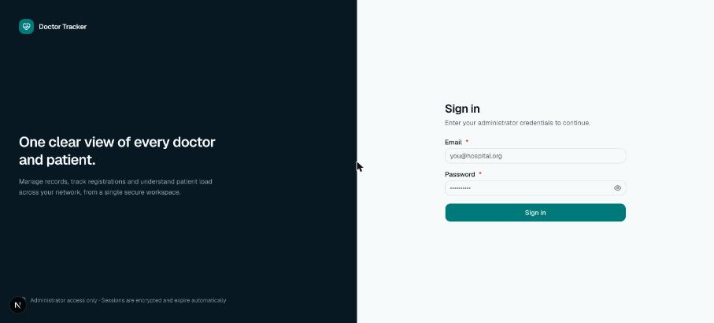
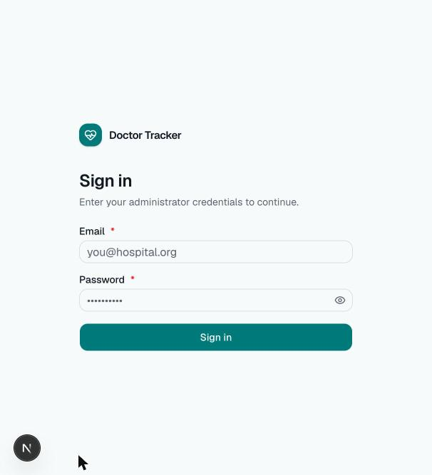
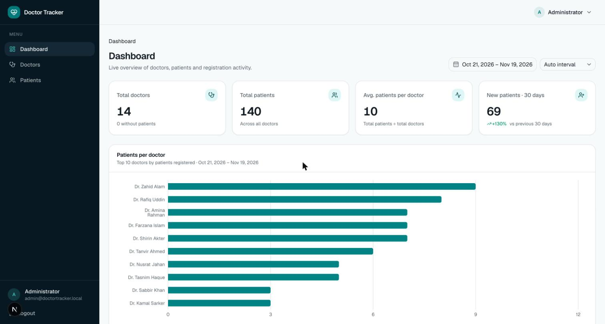
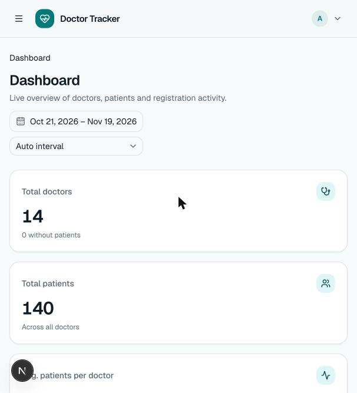
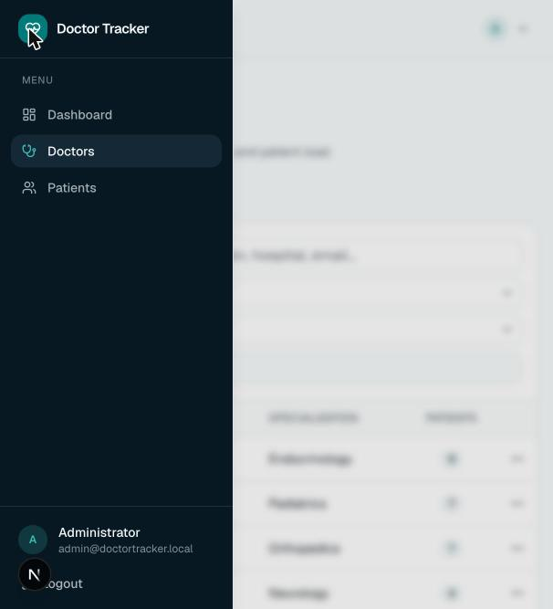
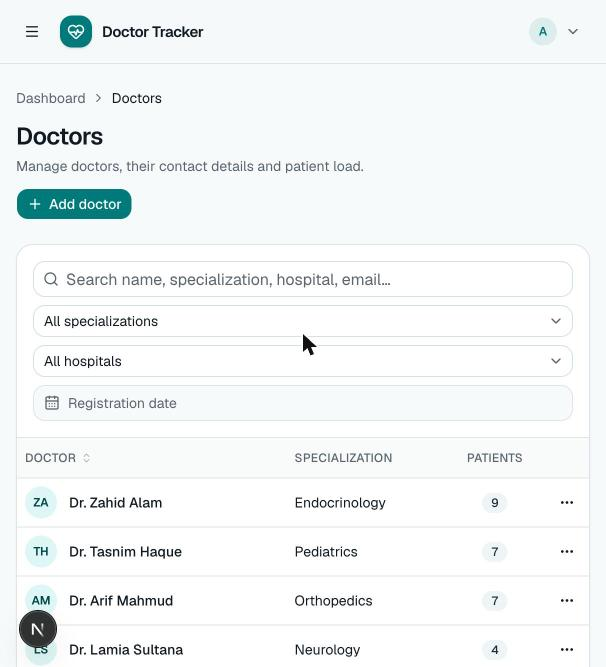
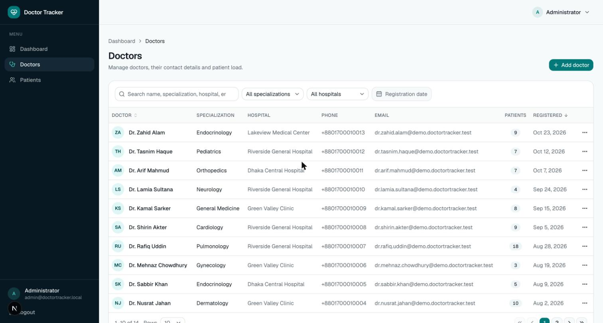
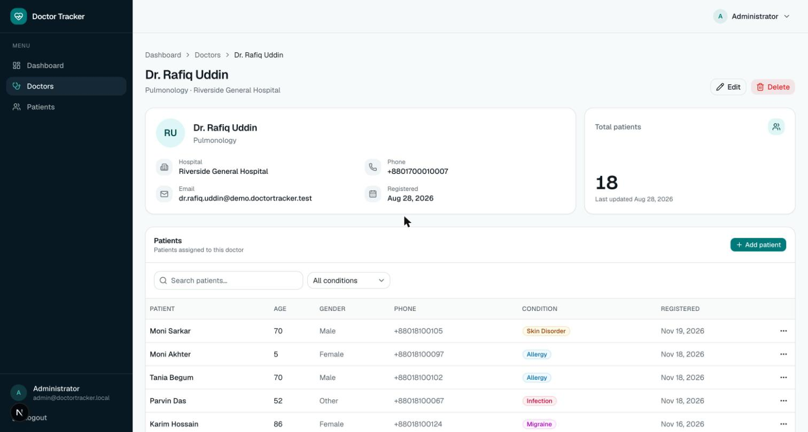
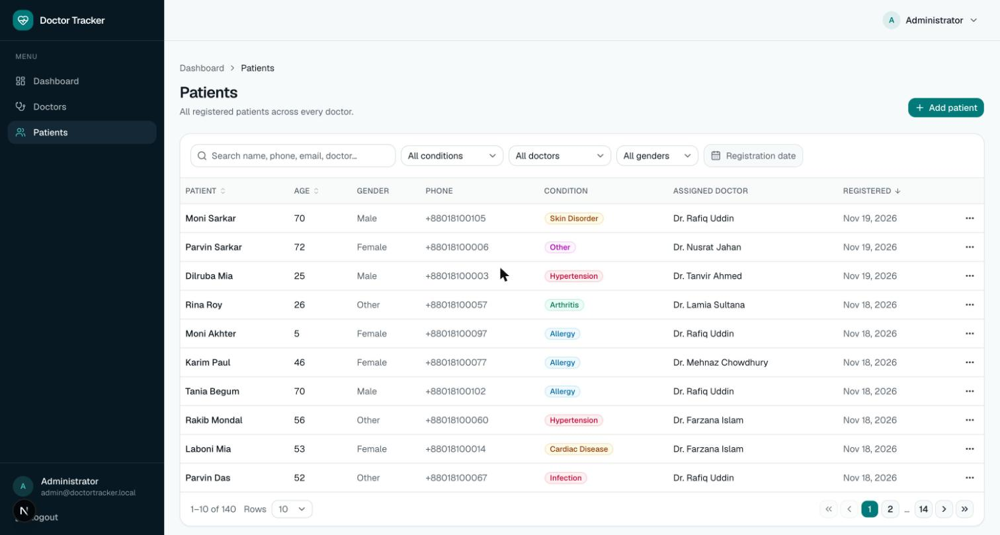
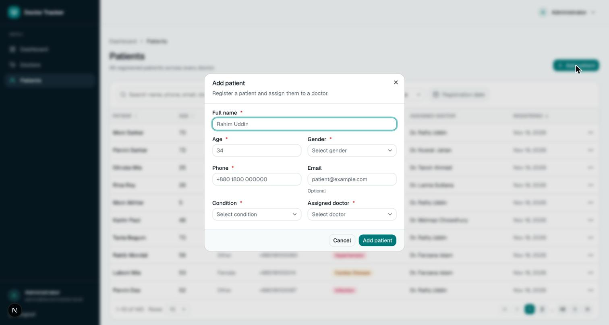

# Doctor Tracker

## Description

Doctor Tracker is a secure administrative web application for managing doctors and their patients. Authenticated administrators can register doctors, assign and maintain patient records, search and filter both collections with server-side pagination, and watch live analytics (patient load per doctor, registration trends, condition and gender mix) rendered from MongoDB aggregation pipelines. It ships as two independently deployable services: a Next.js client and a standalone Express REST API.

## Features

**Authentication & security**
- Email/password login, bcrypt-hashed (12 rounds), JWT stored in an **HttpOnly, Secure, SameSite** cookie (never readable by JS)
- Protected routes on both sides: Next.js `proxy.ts` gate + client session check, and an `authenticate` middleware on every API route except `/auth/login`, `/auth/logout`, `/health`
- Login rate-limiting, Helmet headers, CORS allow-list, Origin check on state-changing requests, constant-time-ish login (no user enumeration)
- First admin is created by a CLI that reads credentials from the environment – no default/public credentials

**Doctors**
- Create / view / edit / delete (name, specialization, hospital, phone, email)
- Search (name, specialization, hospital, email, phone), filters (specialization, hospital, registration date range), sortable columns, server-side pagination, patient count per doctor
- Doctor details page: profile, total patients, patient list (search + condition filter), **add patient under this doctor**, **delete patients from the list**
- Safe deletion policy (see below)

**Patients**
- Dedicated page: list / create / view details / edit / delete
- Search (name, phone, email, assigned doctor name), filters (condition, doctor, gender, registration date range) that combine freely, sortable, server-side pagination
- Filter/search/page state lives in the URL (shareable, refresh-safe); changing a filter resets to page 1

**Dashboard**
- Cards: total doctors, total patients, average patients per doctor, new patients (last 30 days vs. previous 30 – trend shown only when a baseline exists)
- Charts (Recharts): patients per doctor (top 10, click-through), patient registrations, doctor registrations, patients by condition, patients by gender
- Date-range picker with presets + day/week/month interval; all numbers come from the API

**UX / engineering**
- Responsive shell (fixed sidebar ≥ lg, drawer on tablet/mobile), breadcrumbs, user menu, toasts, skeleton/empty/error states, confirm dialogs
- TanStack Query caching + `keepPreviousData` pagination, memoised table/columns/handlers, debounced search, abortable requests
- Reusable components: `DataTable`, `SearchInput`, `FilterDropdown`, `DateRangePicker`, `Pagination`, `ConfirmDialog`, `FormDialog`, `PageHeader`, `StatisticsCard`, `ChartCard`, `EmptyState`, `ErrorState`, skeletons

## Technology Stack

| Layer | Tech |
|---|---|
| Frontend | Next.js 16 (App Router), React 19, TypeScript, Tailwind CSS v4, shadcn/ui (Base UI), Lucide, React Hook Form, Zod, TanStack Query v5, Recharts, Sonner, date-fns |
| Backend | Node.js, Express 5, TypeScript, Mongoose 9, Zod, jsonwebtoken, bcrypt, helmet, cors, express-rate-limit, morgan |
| Database | MongoDB (Atlas-compatible) |
| Testing | Vitest, Supertest, mongodb-memory-server |

```
doctor-tracker/
├── backend/    Express API  (src/{config,controllers,services,models,routes,middleware,validators,utils,scripts})
├── frontend/   Next.js app  (src/{app,components,hooks,services,schemas,providers,lib,types,constants})
├── docs/screenshots/
├── docker-compose.yml   optional local MongoDB
├── render.yaml          API deploy blueprint
└── PROJECT_STATUS.md
```

## Setup Guide

### Prerequisites
- Node.js ≥ 20 (developed on 22) and npm
- MongoDB – pick one: **Atlas** connection string, **Docker** (`docker compose up -d`), or the zero-install helper `npm run dev:db` (downloads a real `mongod` on first run)

### 1. Install
```bash
git clone <your-repo-url> doctor-tracker && cd doctor-tracker
(cd backend && npm install)
(cd frontend && npm install)
```

### 2. Configure environment
```bash
cp backend/.env.example backend/.env
cp frontend/.env.example frontend/.env.local
```
Edit `backend/.env`:
- `MONGODB_URI` – e.g. `mongodb://127.0.0.1:27017/doctor-tracker` or your Atlas URI
- `JWT_SECRET` – `node -e "console.log(require('crypto').randomBytes(48).toString('hex'))"`
- `CORS_ORIGIN` – the frontend origin(s), e.g. `http://localhost:3000`
- `ADMIN_EMAIL`, `ADMIN_PASSWORD` (≥ 10 chars) – used only by the admin CLI

`frontend/.env.local`: `API_URL` – the API base URL (default `http://localhost:5001`).

### 3. Database, admin and demo data
```bash
cd backend
npm run dev:db        # (only if you have no other MongoDB) keep running in its own terminal
npm run admin:create  # creates the first admin from ADMIN_EMAIL / ADMIN_PASSWORD (--reset to change password)
npm run seed          # 14 doctors + 140 patients, spread over ~140 days; safe to re-run (no duplicates)
```
The seed is fully synthetic (`*.test` emails, fake phone numbers) and idempotent (doctors upserted by email, patients by doctor + phone).

### 4. Run
```bash
cd backend  && npm run dev      # API  → http://localhost:5001   (health: /api/health)
cd frontend && npm run dev      # Web  → http://localhost:3000
```
Sign in with the admin credentials you set. If port 3000 is busy: `npx next dev -p 3001` and add that origin to `CORS_ORIGIN`.

### Scripts
| | backend | frontend |
|---|---|---|
| dev | `npm run dev` | `npm run dev` |
| build / start | `npm run build` / `npm start` | `npm run build` / `npm start` |
| checks | `npm run typecheck`, `npm test` (27 tests) | `npx tsc --noEmit`, `npx eslint src` |

## System Architecture

```mermaid
flowchart LR
  subgraph Browser
    UI[Next.js pages<br/>React + TanStack Query]
  end
  subgraph Frontend["Next.js server (Vercel)"]
    P[proxy.ts<br/>cookie gate]
    R["/api/* rewrite"]
  end
  subgraph API["Express API (Render)"]
    MW[helmet · cors · rate-limit · originGuard]
    AU[authenticate<br/>JWT cookie]
    RT[routes → validate(Zod) → controllers → services]
  end
  DB[(MongoDB Atlas<br/>admins · doctors · patients)]

  UI -- "same-origin fetch /api/*" --> R
  UI --> P
  R -- "REST + HttpOnly cookie" --> MW --> AU --> RT
  RT -- "Mongoose: find/aggregate" --> DB
```

**Data flow.** The browser only ever talks to its own origin. `next.config.ts` rewrites `/api/*` to the Express server (`API_URL`), so the session cookie is *first-party* and survives third-party-cookie blocking even though the UI and API are on different hosts. On login the API sets the JWT cookie; every later request carries it and `authenticate` verifies it and confirms the admin still exists. List pages derive their state from the URL → TanStack Query key → `GET /api/...?page&limit&search&filters` → service builds one filtered, sorted, paginated Mongo query (plus a `countDocuments`) → response `{success, message, data, pagination}`. Mutations invalidate the doctors/patients/dashboard query families so counts and charts stay consistent.

**Relationships.** `Patient.doctorId → Doctor._id` (many-to-one, required, validated on create/update). Doctor patient-counts come from one grouped query per page, not per row.

**Backend layering.** `routes` (wiring + Zod `validate`) → `controllers` (HTTP only) → `services` (business logic, queries) → `models` (schemas + indexes). One centralised `errorHandler` maps Zod/Mongoose/duplicate-key/cast errors to a consistent error envelope.

### Doctor deletion policy
A doctor with patients is **never** deleted silently: `DELETE /api/doctors/:id` returns `409` with the patient count. The caller must choose `?reassignTo=<doctorId>` (patients are moved first) or `?cascade=true` (patients are deleted first). Dependent writes happen *before* the doctor is removed, so a failure part-way can never leave orphaned patients. The UI dialog presents exactly these two choices.

### Indexes
| Collection | Index | Serves |
|---|---|---|
| doctors | `{email:1}` unique | duplicate protection |
| doctors | `{createdAt:-1}` | default list + date filter |
| doctors | `{specialization:1, createdAt:-1}`, `{hospital:1, createdAt:-1}` | dropdown filter + sort |
| doctors | `{name:1}` | name sort / `$lookup` |
| patients | `{doctorId:1, createdAt:-1}` | doctor's patients, counts, patients-per-doctor `$group` |
| patients | `{condition:1, createdAt:-1}`, `{gender:1, createdAt:-1}` | filters + sort |
| patients | `{createdAt:-1}` | default list, date filter, registration time-series |
| patients | `{fullName:1}`, `{phone:1}` | sort / search key scans |

## Technical Decisions

### 1. Separate Express API + same-origin proxy with an HttpOnly cookie (instead of Next.js API routes or tokens in `localStorage`)
*Context.* The brief wants a standalone Express server and a separate Next.js client, deployed independently (Vercel + Render) – which normally means a cross-site cookie.
*Decision.* Keep the API fully standalone (it knows nothing about Next.js) and let Next.js **rewrite `/api/*` to it**. The browser sees one origin, so the JWT can live in a `SameSite=Lax; HttpOnly; Secure` cookie.
*Alternatives.* (a) Next.js route handlers – rejected: couples deploys and violates the "separate servers" requirement. (b) JWT in `localStorage` + `Authorization` header – simplest, but any XSS can exfiltrate the token. (c) Direct cross-origin calls with `SameSite=None` – works, but Safari/Chrome third-party-cookie blocking makes it fragile; still supported here via `NEXT_PUBLIC_API_URL` + `COOKIE_SAMESITE=none`.
*Trade-offs.* One extra hop through the Next.js server for each API call (negligible vs. DB time), and `API_URL` must be set at the frontend build/runtime. In return: XSS cannot steal the session, CSRF is mitigated by SameSite plus the API's Origin allow-list, and logout/expiry are server-controlled. `proxy.ts` only gates navigation for UX; **the API re-validates the JWT on every request**, so a forged cookie yields no data.

### 2. Query design: server-side pagination + batched lookups + aggregation pipelines (instead of `populate`/N+1 or client-side paging)
*Context.* The spec grades query optimisation for search, filter, pagination and analytics.
*Decision.* Every list is `find(filter).sort().skip().limit().lean()` + `countDocuments(filter)` in parallel; related data is attached with **one** `$in` query for the page (doctor counts via a grouped aggregation hitting `{doctorId, createdAt}`; patient→doctor names via a single `find({_id:{$in}})`). Searching patients by *doctor name* resolves matching doctor ids first and filters on `doctorId $in`, avoiding a `$lookup` over every patient. Dashboard figures use pipelines (`$group`, `$dateTrunc` bucketing, `$lookup` only on the top-N rows with a projected sub-pipeline) and zero-fill missing buckets in the service so charts have continuous axes.
*Alternatives.* Mongoose `populate` on each list (extra round trip per query, hidden fan-out); `$lookup` joins for counts (scans the patients collection per doctor page); loading everything and paging in React (doesn't scale); `skip/limit` vs cursor pagination (cursor is faster for deep pages but the UI needs jump-to-page and totals).
*Trade-offs.* `skip` gets slower on very deep pages and `countDocuments` is O(matching docs). Search uses an escaped, case-insensitive substring regex, which cannot use an index efficiently – acceptable for admin-scale data, and the documented upgrade path is MongoDB Atlas Search (or a `text` index for word-prefix search). Indexes are chosen from the actual filters above rather than indexing every field.

## API Documentation

Base URL: `/api` (e.g. `http://localhost:5001/api`). All endpoints except those marked *public* require the session cookie (or `Authorization: Bearer <jwt>`). JSON in/out.

Success envelope: `{ "success": true, "message": "...", "data": ..., "pagination": {page, limit, total, totalPages}? }`
Error envelope: `{ "success": false, "message": "...", "code": "VALIDATION_ERROR|UNAUTHORIZED|NOT_FOUND|CONFLICT|DUPLICATE|...", "errors": [{ "field", "message" }]? }`
Status codes: `200/201` ok · `400` validation/bad id · `401` unauthenticated · `403` bad origin · `404` · `409` conflict/duplicate · `429` rate-limited · `500`.

### Health & auth
| Method & path | Auth | Notes |
|---|---|---|
| `GET /health` | public | `200 {status:"ok"}` / `503` when DB is down |
| `POST /auth/login` | public (rate-limited 10/15 min) | body `{email, password}` → sets cookie, `data.admin` |
| `POST /auth/logout` | public | clears cookie |
| `GET /auth/me` | yes | current admin |

### Doctors
| Method & path | Notes |
|---|---|
| `POST /doctors` | body `{name, specialization, hospital, phone, email}` → `201` (email unique → `409`) |
| `GET /doctors` | query: `page, limit(≤100), search, specialization, hospital, from, to (YYYY-MM-DD), sortBy(createdAt\|name), order` · each item has `patientCount` |
| `GET /doctors/filters` | `{specializations[], hospitals[]}` for dropdowns |
| `GET /doctors/options` | lightweight `[{id,name,specialization}]` for selectors |
| `GET /doctors/:id` | doctor + `patientCount` |
| `PATCH /doctors/:id` | any subset of the create fields |
| `DELETE /doctors/:id` | `409` if patients exist; `?reassignTo=<id>` or `?cascade=true` – returns `{reassigned, removedPatients}` |
| `GET /doctors/:id/patients` | same query params as `/patients` (minus `doctorId`) |
| `POST /doctors/:id/patients` | create a patient under this doctor (body = patient fields, doctor taken from URL) |

### Patients
| Method & path | Notes |
|---|---|
| `POST /patients` | body `{fullName, age(0–120), gender(male\|female\|other), phone, email?, condition, doctorId}` · doctor must exist |
| `GET /patients` | query: `page, limit, search(name/phone/email/doctor name), condition, gender, doctorId, from, to, sortBy(createdAt\|fullName\|age), order` |
| `GET /patients/:id` | includes `doctor:{id,name,specialization,hospital}` |
| `PATCH /patients/:id` | any subset; `email: ""` clears it; changing `doctorId` re-validates |
| `DELETE /patients/:id` | |

Patient conditions: Diabetes, Hypertension, Asthma, Cardiac Disease, Arthritis, Migraine, Allergy, Infection, Injury, Skin Disorder, Pregnancy Care, Other (single list in `backend/src/config/constants.ts`).

### Dashboard
| Method & path | Notes |
|---|---|
| `GET /dashboard/overview?days=30` | `{totalDoctors, totalPatients, averagePatientsPerDoctor, doctorsWithoutPatients, newDoctors, newPatients}` – the `new*` objects hold `{current, previous, changePercent|null}` |
| `GET /dashboard/patients-per-doctor?from&to&limit=10` | `[{doctorId, name, specialization, patientCount}]` ordered desc |
| `GET /dashboard/statistics?from&to&interval=day\|week\|month` | `{range, totals, series:[{date,doctors,patients}], conditions[], gender[]}`; default window = last 30 days; interval auto-chosen if omitted |

Example – `GET /api/doctors?page=1&limit=2`
```json
{
  "success": true,
  "message": "Doctors retrieved successfully",
  "data": [{ "id": "…", "name": "Dr. Zahid Alam", "specialization": "Endocrinology", "hospital": "Lakeview Medical Center",
             "phone": "+8801700010013", "email": "dr.zahid.alam@demo.doctortracker.test", "patientCount": 9,
             "createdAt": "2026-10-23T…", "updatedAt": "2026-10-23T…" }],
  "pagination": { "page": 1, "limit": 2, "total": 14, "totalPages": 7 }
}
```

## Visual Evidence

Captured from the running application with the seeded demo data (no mock-ups).

| Login (desktop) | Login (mobile) |
|---|---|
|  |  |

**Dashboard – desktop**


| Dashboard – mobile | Mobile navigation | Doctors – mobile |
|---|---|---|
|  |  |  |

**Doctors**


**Doctor details (profile + patients)**


**Patients**


**Patient form**


## Testing
`cd backend && npm test` – 27 integration tests against an in-memory MongoDB: auth (login, cookie flags, bcrypt hash, no user enumeration, tampered token, logout, Origin guard), doctor CRUD/validation/duplicates/search/filter/sort/pagination/regex-safety, the full deletion policy, patient CRUD + relationship integrity, combined filters, inclusive date ranges, and dashboard aggregation (empty DB, real data, mutation → updated numbers, trend, zero-filled buckets).
The UI was verified manually in a browser (login/logout, route protection, doctor create/validation/delete, add patient, URL-driven filters, charts, 390 px mobile layout); there are no automated frontend tests yet.

## Deployment

**Database – MongoDB Atlas:** create a free cluster, a database user, allow your API host's IPs, and copy the SRV connection string.

**Backend – Render** (`render.yaml` included, or create a Web Service manually)
- Root directory `backend`; build `npm ci --include=dev && npm run build`; start `npm start`; health check `/api/health`
- Env: `NODE_ENV=production`, `MONGODB_URI`, `JWT_SECRET` (long random), `JWT_EXPIRES_IN=8h`, `COOKIE_SAMESITE=lax`, `CORS_ORIGIN=https://<your-frontend-domain>`
- One-off, from the Render shell (or locally against the Atlas URI): `ADMIN_EMAIL=… ADMIN_PASSWORD=… npm run admin:create` and optionally `npm run seed`

**Frontend – Vercel (or Netlify)**
- Root directory `frontend`; framework Next.js; env `API_URL=https://<your-render-service>.onrender.com`
- Because `/api/*` is proxied, no third-party cookie issues; if you prefer direct calls set `NEXT_PUBLIC_API_URL=https://<api>/api` **and** `COOKIE_SAMESITE=none` on the API
- Verify: `curl https://<frontend>/api/health` should return the API's health JSON, then sign in

> **Status:** deployment configuration is complete, but the app has **not** been deployed from this repository (no hosting or Atlas credentials were available). The steps above are the remaining manual work.

## Assumptions
- The PDF doesn't list patient fields; the model is `fullName, age, gender, phone, email?, condition, doctorId` with a controlled condition list (extend in one file).
- The PDF's tech-stack section mentions both "full-stack inside Next.js" and "separate client + standalone server"; this project implements the separate-services option.
- Admins are not self-service; accounts are created with the CLI.

## Deploying to your own server (VPS + nginx + pm2)

`deploy/` contains a one-command deployment for a Linux VPS, used for `api.mdrakibulislam.dev` and `doctorportal.mdrakibulislam.dev`:

```bash
./deploy/deploy.sh                 # prompts for the SSH password once
# optional real TLS on the origin:  ENABLE_TLS=1 TLS_EMAIL=you@example.com ./deploy/deploy.sh
```
What it does: uploads the source (no secrets, no `node_modules`), writes the server-side `.env` (Atlas URI copied from your local `backend/.env`, a fresh `JWT_SECRET` generated on the server), picks free ports (API from 5001, web from 3001 – existing listeners are never touched), installs Node 22 via nvm if needed, builds both apps, runs them under pm2 (auto-restart + `@reboot` resurrect), and writes an nginx config for both domains (needs `sudo`; otherwise the config is saved for the admin). The frontend reaches the API over loopback (`API_URL=http://127.0.0.1:<port>`), the browser only talks to the frontend domain, so the HttpOnly cookie stays first-party. Re-running the script is a safe redeploy.

DNS: both domains must resolve to the server (if proxied through Cloudflare, use SSL mode *Flexible* with the default HTTP-only nginx, or *Full* together with `ENABLE_TLS=1`).
